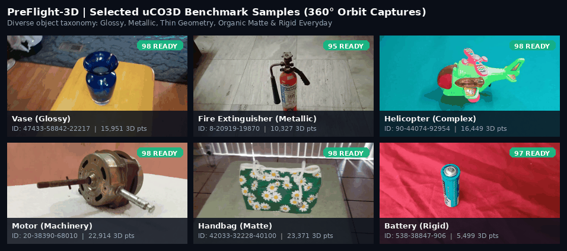
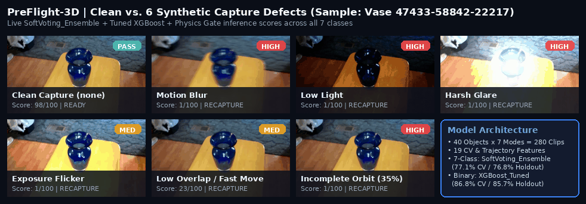
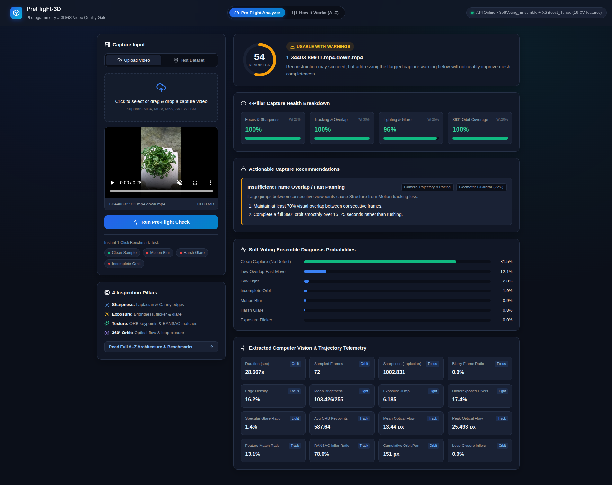
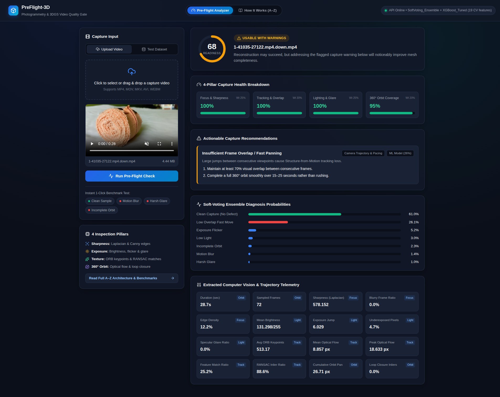
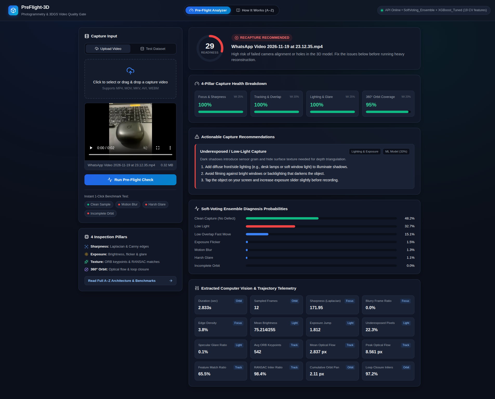

<div align="center">

# PreFlight-3D

### Pre-Flight Computer Vision & ML Quality Gate for 3D Reconstruction Captures

*Catch blurry frames, specular glare, exposure flicker, and broken 360° orbits in ~0.5 seconds on CPU — before wasting compute on COLMAP, NeRF, or 3D Gaussian Splatting.*

[](#tech-stack)
[](#api-endpoints)
[](#quick-start)
[](#model-results--benchmark-performance)
[-8B5CF6)](#a-to-z-pipeline-walkthrough)

</div>

---

## Visual Showcase: Selected Samples & Failure Modes

### 1. Selected uCO3D Benchmark Captures (Diverse Object Taxonomy)
We curated **40 object-centric sequences across 40 categories** from Meta's [uCO3D](https://github.com/facebookresearch/uco3d) dataset spanning five reconstruction difficulty groups: *Transparent & Glossy*, *Metallic & Reflective*, *Thin & Complex Geometry*, *Organic & High-Texture Matte*, and *Rigid Everyday Objects*.



> **Verified Live Inference on Clean Captures:** All six representative captures above achieve `95–98 / 100` Readiness Scores (`READY_FOR_RECONSTRUCTION`) with `5,499` to `23,371` ground-truth segmented 3D points.

---

### 2. Clean vs. 6 Synthetic Capture Defects (Live Hybrid Diagnosis)
From each clean 360° orbit capture, we synthesized **6 realistic photogrammetry failure modes** (`240` degraded videos + `40` clean = **`280` labeled clips**) and evaluated every variant through the final `SoftVoting_Ensemble` + `XGBoost_Tuned` + Physics Verification Gate pipeline:



---

## Why PreFlight-3D?

Running Structure-from-Motion (COLMAP), NeRF, or 3D Gaussian Splatting (3DGS) on a flawed smartphone capture wastes minutes to hours of GPU/CPU time only to produce floating artifacts, melted geometry, or missing backsides.

**PreFlight-3D** acts as a fast, deterministic + machine-learning **pre-flight checklist**:
- **CPU-First Speed:** Samples frames at `2.5 FPS` (`480px` max side) inside an elliptical subject ROI — extracting **19 CV & camera trajectory features** in ~0.3–0.5s per video with no GPU required.
- **Zero-Leakage Evaluation:** All models are trained and validated with **5-Fold `StratifiedGroupKFold` grouped by `sequence_id`**, guaranteeing all 7 variants of an object stay in the same fold.
- **Hybrid ML + Physics Gate:** Combines learned ensemble probabilities with deterministic physical thresholds and loop-closure guardrails (`_passes_physics_verification`) to suppress false positives on real-world turntable and indoor captures.
- **Actionable Remediation:** Returns a `0–100` Readiness Score, a 3-tier verdict (`READY_FOR_RECONSTRUCTION`, `USABLE_WITH_WARNINGS`, `RECAPTURE_RECOMMENDED`), defect probabilities, and concrete camera/lighting fixes.

---

## A-to-Z Pipeline Walkthrough

```mermaid
flowchart LR
    A["A. uCO3D Setup<br/>setup_uco3d.sh"] --> B["B. Subset Download<br/>8.71 GB examples.zip<br/>52 categories"]
    B --> C["C. Curate & Extract<br/>40 objects @ 2 FPS<br/>7,999 cam rows"]
    C --> D["D. 3D Baseline Audit<br/>1.000 visibility<br/>18,361 mean 3D pts"]
    D --> E["E. Synthetic Defects<br/>6 failure modes x 40<br/>= 280 labeled clips"]
    E --> F["F. CV Feature Extraction<br/>19 sharpness, light,<br/>texture & orbit metrics"]
    F --> G["G. Group-CV Training<br/>RF, XGBoost, LightGBM<br/>+ SoftVoting Ensemble"]
    G --> H["H. Hybrid Physics Gate<br/>ML + CV verification<br/>& 0-100 scoring"]
    H --> I["I. Full-Stack App<br/>FastAPI + React 19<br/>Live Dashboard"]
```



### Stage A — Toolkit & Environment Setup
- **Script:** [`scripts/setup_uco3d.sh`](scripts/setup_uco3d.sh)
- Installs core CV/3D dependencies (`opencv-python-headless`, `numpy`, `pandas`, `pyyaml`, `tqdm`, `trimesh`) and clones Meta's official `facebookresearch/uco3d` repository into `external/uco3d`.

### Stage B — Lightweight uCO3D Subset Acquisition
- **Script:** [`ml_pipeline/dataset_builder/01_download_subset.py`](ml_pipeline/dataset_builder/01_download_subset.py)
- Downloads `examples.zip` (`8.71 GB`) from `facebook/uco3d` on Hugging Face, **selectively extracts only** `.mp4`, `.mkv`, `.ply`, `.sqlite`, and `.json` (skipping heavy `gaussian_splats`), and immediately deletes the archive to save ~75% disk space.
- Yielded **52 object categories / 52 sequences** (`data/processed/video_metadata/available_categories.csv`).

### Stage C — 40-Category Curation & Multi-Modal Extraction
- **Script:** [`ml_pipeline/dataset_builder/02_select_and_organize.py`](ml_pipeline/dataset_builder/02_select_and_organize.py) & [`ml_pipeline/dataset_builder/config.yaml`](ml_pipeline/dataset_builder/config.yaml)
- Selects **40 diverse sequences** across 40 categories (`23` portrait `1080x1920`, `15` landscape `1920x1080`, `1` `1920x1088`, `1` `3840x2160`; `21.15` total minutes of source footage):
  - **Transparent & Glossy (5):** `wineglass`, `water_bottle`, `perfume`, `vase`, `ashtray`
  - **Metallic & Reflective (8):** `bass_horn`, `pot`, `flashlight`, `aerosol_can`, `fire_extinguisher`, `motor`, `binoculars`, `cooker`
  - **Thin & Complex Geometry (6):** `shopping_cart`, `chair`, `helicopter`, `speaker_stero_equipment`, `telephone`, `funnel`
  - **Organic & High-Texture Matte (12):** `shoe`, `teddy_bear`, `pinecone`, `handbag`, `pillow`, `hand_towel`, `shirt`, `cap_headwear`, `muffin`, `bagel`, `onion`, `orange_fruit`
  - **Rigid Everyday Objects (9):** `book`, `mouse_computer_equipment`, `flowerpot`, `sculpture`, `first-aid_kit`, `battery`, `dog_collar`, `dustpan`, `scraper`
- Symlinks original `.mp4` streams (zero duplicate storage), copies `.ply` point clouds, extracts `2 FPS` RGB frames + binary foreground masks, and exports **7,999 camera annotation rows** (`frame_annots_selected.csv`).

### Stage D — Baseline 3D Reconstruction & Quality Inspection
- **Script:** [`ml_pipeline/dataset_builder/03_inspect_and_measure.py`](ml_pipeline/dataset_builder/03_inspect_and_measure.py)
- Audits all 40 clean sequences against their ground-truth `.ply` point clouds and foreground masks (`baseline_quality.csv`):
  - **Mean Object Visible Frame Ratio:** `1.000`
  - **Mean Segmented 3D Object Points:** `18,360.7`
  - **Mean Sparse SfM Points:** `16,047.5`

### Stage E — Synthetic Capture Failure Generation (280 Labeled Videos)
- **Script:** [`ml_pipeline/dataset_builder/04_generate_degraded_videos.py`](ml_pipeline/dataset_builder/04_generate_degraded_videos.py)
- Keeps the 40 clean sequences (`none` / `GOOD`) and synthesizes **6 failure modes** per object at `MAX_DIM = 640` (`240` `POOR` samples → **`280` total samples** in `dataset_manifest.csv`):

| Defect Label | Simulation Method | Real-World 3D Failure Impact | Samples |
| :--- | :--- | :--- | :---: |
| `none` | Original clean uCO3D capture | Healthy baseline for COLMAP / 3DGS | 40 |
| `motion_blur` | `19×19` directional blur kernel | Destroys ORB/SIFT keypoints; melted surfaces | 40 |
| `low_light` | Gamma `2.5` darkening + Gaussian sensor noise (`σ=8`) | Hides surface texture; heavy sensor grain | 40 |
| `harsh_glare` | Overexposure (`α=1.55, β=45`) + specular mask hotspot | View-dependent highlights break triangulation | 40 |
| `exposure_flicker` | Auto-exposure pumping (`1.45×` / `0.55×` every 12 frames) | Color banding & unstable feature descriptors | 40 |
| `low_overlap_fast_move` | 67% frame drop (keeps every 3rd frame) | Large viewpoint jumps cause SfM tracking loss | 40 |
| `incomplete_orbit` | Truncated to first `35%` of orbit duration | Missing back/side views leave holes in mesh | 40 |

### Stage F — 19-Feature CV & Geometric Trajectory Extraction
- **Scripts:** [`ml_pipeline/feature_extraction/extractor.py`](ml_pipeline/feature_extraction/extractor.py) & [`ml_pipeline/feature_extraction/run_batch_extraction.py`](ml_pipeline/feature_extraction/run_batch_extraction.py)
- Samples frames at `2.5 FPS` (minimum 12 frames), resizes to `max_dim=480`, and computes **19 standardized features** inside an elliptical center subject mask (`68% × 72%` axes):

| Feature Group | Features (`19` Total) |
| :--- | :--- |
| **Temporal / Sampling (2)** | `duration_sec`, `sampled_frames` |
| **Sharpness & Edges (4)** | `laplacian_var_mean`, `laplacian_var_p10`, `blurry_frame_ratio` (`lap < 35`), `edge_density_mean` (Canny `80/160`) |
| **Lighting & Glare (5)** | `brightness_mean`, `brightness_std`, `brightness_step_diff_mean`, `dark_pixel_ratio` (`gray < 40`), `specular_glare_ratio` (`V > 240 & S < 45`) |
| **Surface Texture (2)** | `orb_keypoints_mean`, `orb_keypoints_min` (`ORB nfeatures=600`) |
| **Motion & Orbit Coverage (6)** | `optical_flow_mean`, `optical_flow_max` (Farneback), `pair_match_ratio_mean`, `pair_inlier_ratio_mean` (BFMatcher + RANSAC homography), `cumulative_pan_px`, `loop_closure_inlier_ratio` (start-to-end frame RANSAC) |

#### Observed Feature Separation Across Defect Classes (`extracted_features.csv` Means)

| Defect Type | Duration (s) | Laplacian Var | Blurry Ratio | Brightness | Step Diff | Dark Ratio | Glare Ratio | ORB KPs | Flow Mean | Loop Closure |
| :--- | :---: | :---: | :---: | :---: | :---: | :---: | :---: | :---: | :---: | :---: |
| **`none` (Clean)** | `31.73` | **`655.00`** | `0.005` | `119.45` | `3.99` | `0.094` | `0.007` | **`452.84`** | `9.72` | **`0.533`** |
| `motion_blur` | `31.73` | **`47.99`** | **`0.530`** | `117.58` | `3.98` | `0.085` | `0.005` | **`139.14`** | `6.21` | `0.355` |
| `low_light` | `31.73` | `449.13` | `0.000` | **`57.71`** | `3.42` | **`0.452`** | `0.004` | `385.48` | `8.42` | `0.512` |
| `harsh_glare` | `31.73` | `173.53` | `0.239` | **`223.55`** | `3.08` | `0.000` | **`0.597`** | `251.80` | `8.44` | `0.381` |
| `exposure_flicker` | `31.73` | `431.26` | `0.079` | `123.49` | **`76.58`** | `0.126` | `0.110` | `395.43` | `9.60` | `0.532` |
| `low_overlap_fast_move` | `31.76` | `364.79` | `0.021` | `117.63` | `3.97` | `0.099` | `0.007` | `436.04` | `9.48` | `0.521` |
| `incomplete_orbit` | **`11.12`** | `395.63` | `0.020` | `117.11` | `3.71` | `0.102` | `0.007` | `444.03` | `9.11` | **`0.095`** |

---

### Stage G — Model Training, Hyperparameter Tuning & Evaluation
- **Scripts:** [`ml_pipeline/training/train_models.py`](ml_pipeline/training/train_models.py) & [`ml_pipeline/evaluation/evaluate_models.py`](ml_pipeline/evaluation/evaluate_models.py)
- **Algorithms Evaluated:** **Random Forest**, **XGBoost**, and **LightGBM** across 3 progressive stages:
  1. `1_Baseline` (class-balanced defaults)
  2. `2_Tuned` (`RandomizedSearchCV`, `n_iter=12`, scoring `f1_macro`, 5-Fold `StratifiedGroupKFold`)
  3. `3_Ensemble` (`SoftVoting_Ensemble` combining the 3 tuned models)
- **Leakage Prevention:** Grouped strictly by `sequence_id` (`32` training objects / `224` clips vs. `8` unseen holdout objects / `56` clips per fold).

---

## Model Results & Benchmark Performance

### Task 1: 7-Class Defect Diagnosis (`Defect_Diagnosis_7Class`)

| Stage | Model | 5-Fold CV Accuracy | CV Std | CV Macro F1 | Holdout Accuracy | Holdout Macro F1 |
| :--- | :--- | :---: | :---: | :---: | :---: | :---: |
| `1_Baseline` | RandomForest | `73.93%` | `0.0571` | `0.7267` | `73.21%` | `0.7430` |
| `1_Baseline` | XGBoost | `76.07%` | `0.0720` | `0.7516` | `76.79%` | `0.7640` |
| `1_Baseline` | LightGBM | `75.36%` | `0.0602` | `0.7470` | `75.00%` | `0.7577` |
| `2_Tuned` | RandomForest_Tuned | `76.07%` | `0.0702` | `0.7491` | `76.79%` | `0.7617` |
| `2_Tuned` | XGBoost_Tuned | `76.43%` | `0.0398` | `0.7607` | `73.21%` | `0.7287` |
| `2_Tuned` | LightGBM_Tuned | `76.43%` | `0.0633` | `0.7619` | **`78.57%`** | **`0.7990`** |
| `3_Ensemble` | **`SoftVoting_Ensemble` (Winner)** | **`77.14%`** | `0.0522` | **`0.7655`** | `76.79%` | `0.7721` |

### Task 2: Binary Capture Readiness Gate (`Readiness_Binary`: `GOOD` vs. `POOR`)

| Stage | Model | 5-Fold CV Accuracy | CV Std | CV Macro F1 | Holdout Accuracy | Holdout Macro F1 |
| :--- | :--- | :---: | :---: | :---: | :---: | :---: |
| `1_Baseline` | RandomForest | `83.21%` | `0.0182` | `0.7021` | `80.36%` | `0.7168` |
| `1_Baseline` | XGBoost | `86.07%` | `0.0208` | `0.7150` | **`87.50%`** | **`0.7573`** |
| `1_Baseline` | LightGBM | `83.93%` | `0.0226` | `0.6809` | `85.71%` | `0.7352` |
| `2_Tuned` | RandomForest_Tuned | `84.64%` | `0.0182` | `0.7268` | `83.93%` | `0.7363` |
| `2_Tuned` | **`XGBoost_Tuned` (Winner)** | **`86.79%`** | `0.0143` | **`0.7302`** | `85.71%` | `0.7352` |
| `2_Tuned` | LightGBM_Tuned | `85.36%` | `0.0262` | `0.6975` | `85.71%` | `0.7352` |
| `3_Ensemble` | SoftVoting_Ensemble | `85.00%` | `0.0182` | `0.7092` | `85.71%` | `0.7352` |

---

### Final Production Models & Configuration
Selected automatically by highest **5-Fold `StratifiedGroupKFold` Macro F1** and bundled into [`models/preflight_model_bundle.joblib`](models/preflight_model_bundle.joblib) (schema in [`models/feature_schema.json`](models/feature_schema.json)):

1. **7-Class Defect Diagnosis Model:** **`SoftVoting_Ensemble`** (`RandomForest_Tuned` + `XGBoost_Tuned` + `LightGBM_Tuned`)
   - **5-Fold CV:** `77.14%` Accuracy | `0.7655` Macro F1
   - **Unseen Holdout (56 videos / 8 objects):** `76.79%` Accuracy | `0.7721` Macro F1
   - **Tuned Hyperparameters:**
     - `RandomForest`: `n_estimators=350`, `min_samples_split=4`, `min_samples_leaf=3`, `max_features="sqrt"`, `max_depth=None`
     - `XGBoost`: `n_estimators=150`, `max_depth=4`, `learning_rate=0.03`, `subsample=0.85`, `colsample_bytree=0.7`, `reg_alpha=1.0`, `reg_lambda=2.0`
     - `LightGBM`: `n_estimators=150`, `max_depth=3`, `num_leaves=23`, `learning_rate=0.08`, `min_child_samples=10`, `subsample=0.85`, `colsample_bytree=0.85`, `reg_lambda=1.0`

2. **Binary Readiness Gate Model:** **`XGBoost_Tuned`**
   - **5-Fold CV:** `86.79%` Accuracy | `0.7302` Macro F1 (lowest CV variance: `±0.0143`)
   - **Unseen Holdout:** `85.71%` Accuracy | `0.7352` Macro F1
   - **Tuned Hyperparameters:** `n_estimators=220`, `max_depth=5`, `learning_rate=0.08`, `subsample=0.75`, `colsample_bytree=1.0`, `reg_alpha=0.5`, `reg_lambda=1.0`, `scale_pos_weight=6.0`

### Unseen Object Holdout Breakdown (`SoftVoting_Ensemble`, 56 Test Videos)

| Defect Class | Precision | Recall | F1-Score | Support | Diagnostic Insight |
| :--- | :---: | :---: | :---: | :---: | :--- |
| `harsh_glare` | `1.000` | `1.000` | **`1.000`** | 8 | Perfect separation via `specular_glare_ratio` & `brightness_mean` |
| `incomplete_orbit` | `1.000` | `0.875` | **`0.933`** | 8 | Strong separation via `loop_closure_inlier_ratio` & `duration_sec` |
| `low_light` | `1.000` | `0.875` | **`0.933`** | 8 | Strong separation via `dark_pixel_ratio` & `brightness_mean` |
| `motion_blur` | `1.000` | `0.750` | **`0.857`** | 8 | Captured cleanly by `laplacian_var_mean` & `blurry_frame_ratio` |
| `exposure_flicker` | `0.778` | `0.875` | **`0.824`** | 8 | Captured by `brightness_step_diff_mean` (`76.58` vs `3.99` clean) |
| `none` (Clean) | `0.462` | `0.750` | `0.571` | 8 | Some false overlap with `low_overlap_fast_move` |
| `low_overlap_fast_move` | `0.333` | `0.250` | `0.286` | 8 | 2.5 FPS downsampling masks 3× frame-drop gaps at feature time |

> **Why Hybrid Physics Guardrails Matter:** Because `extractor.py` samples at `2.5 FPS`, synthetic `low_overlap_fast_move` (created by dropping 2/3 of frames at `1/3` FPS, keeping total video duration constant) shares similar sampled optical flow with slow clean captures. To overcome this limitation in production, [`recommendation_engine.py`](backend/app/services/recommendation_engine.py) pairs ML probabilities with deterministic **physics verification gates** and **geometric/trajectory guardrails** (`pair_inlier_ratio_mean < 0.22` or `optical_flow_max > 22.0`).

### Top 10 Consensus Feature Importances
Averaged normalized gain/impurity across the tuned RF + XGBoost + LightGBM ensemble:

| Rank | Feature | Importance | Primary Diagnostic Role |
| :---: | :--- | :---: | :--- |
| 1 | `dark_pixel_ratio` | `0.1574` | Underexposure & shadow clipping |
| 2 | `brightness_mean` | `0.1503` | Global exposure & overexposure |
| 3 | `laplacian_var_mean` | `0.0898` | Mean subject sharpness / motion blur |
| 4 | `duration_sec` | `0.0842` | Capture pacing & truncated orbits |
| 5 | `brightness_step_diff_mean` | `0.0795` | Auto-exposure pumping / flicker |
| 6 | `specular_glare_ratio` | `0.0794` | Specular hotspot detection |
| 7 | `sampled_frames` | `0.0629` | Temporal sample coverage |
| 8 | `brightness_std` | `0.0604` | Luminance variance across orbit |
| 9 | `laplacian_var_p10` | `0.0499` | Worst-decile frame blur |
| 10 | `blurry_frame_ratio` | `0.0418` | Fraction of frames below sharpness floor |

---

## Hybrid Inference & Scoring Architecture

Inside [`backend/app/services/recommendation_engine.py`](backend/app/services/recommendation_engine.py), `PreFlightAnalyzer.analyze_video()` executes a 4-stage pipeline:
1. **ML Probability Inference:** Runs `SoftVoting_Ensemble` (7-class) + `XGBoost_Tuned` (binary readiness).
2. **Physics Verification Gate (`_passes_physics_verification`):** Validates flagged ML defects (`prob >= 0.25`) against physical measurements (e.g., suppressing false `incomplete_orbit` warnings when `loop_closure_inlier_ratio >= 0.50` and `optical_flow_mean >= 2.0`, and suppressing false `exposure_flicker` on normal directional indoor lighting gradients where `brightness_step_diff_mean < 18.0`).
3. **Deterministic Guardrails:** Flags `low_overlap_fast_move` (`pair_inlier_ratio_mean < 0.22` or `optical_flow_max > 22.0`), `incomplete_orbit` (`loop_closure_inlier_ratio < 0.35`, `cumulative_pan_px < 20.0`, `duration_sec < 9.0`), and `low_surface_texture` (`orb_keypoints_mean < 35` & `laplacian_var_mean > 80`).
4. **Calibrated Readiness Score (`0–100`) & Verdict:**
   - Clean (`0` issues): Weighted blend of deterministic CV Health Score (`60%`) + ML clean confidence (`40%`), clamped to `[65, 98]` → **`READY_FOR_RECONSTRUCTION`** (`>= 70`).
   - Mild warnings (`1` non-high issue): Score `[45, 68]` → **`USABLE_WITH_WARNINGS`**.
   - High-severity or multiple issues: Score `[1, 44]` → **`RECAPTURE_RECOMMENDED`**.

---

## API Endpoints & Full-Stack Dashboard

### FastAPI Backend ([`backend/app/main.py`](backend/app/main.py) & [`backend/app/api/routes.py`](backend/app/api/routes.py))
- `GET /api/health` — Returns active models (`SoftVoting_Ensemble`, `XGBoost_Tuned`) and feature count (`19`).
- `POST /api/analyze` — Accepts `.mp4`, `.mov`, `.mkv`, `.avi`, `.webm` upload and returns full JSON diagnosis.
- `GET /api/samples` — Lists 14 curated benchmark samples (2 per defect category) from `dataset_manifest.csv`.
- `POST /api/analyze-sample/{sample_id}` — Runs live feature extraction + ensemble inference on a selected local dataset sample.

### React 19 + Vite Dashboard ([`frontend/src/App.jsx`](frontend/src/App.jsx) & [`frontend/src/pages/HowItWorks.jsx`](frontend/src/pages/HowItWorks.jsx))
- **Pre-Flight Analyzer:** Drag-and-drop video uploader with HTML5 preview, **Test Dataset** selector + 1-click preset chips, animated SVG Readiness Gauge, 4-Pillar Capture Health Breakdown, Actionable Capture Recommendations, Soft-Voting Ensemble probability bars, and 16-tile CV Telemetry readout.
- **How It Works (A–Z):** Interactive architecture walkthrough covering the Problem vs. Hybrid Solution, Stage A → I pipeline explorer, sample & defect GIF showcases, 40-category taxonomy, benchmark tables, and completed output gallery.

---

## Completed Final Output — Live Dashboard Results

Below are three completed end-to-end inference outputs captured directly in the live PreFlight-3D dashboard on uploaded test and smartphone captures:

### 1. Geometric Guardrail Catch — Fast Panning (`54 / 100` · `USABLE WITH WARNINGS`)
- **Video:** `1-34403-89911.mp4.down.mp4` (`28.667s`, `13.00 MB`, potted plant capture)
- **Diagnostic Proof:** Even though the raw ML classifier scored Clean at `81.5%`, **Peak Optical Flow spiked to `25.493 px`** (`Mean Optical Flow: 13.44 px`), triggering the deterministic **Geometric Guardrail (`72%`)** to warn about insufficient frame overlap.



### 2. Ensemble Overlap Warning — Moderate Fast Move (`68 / 100` · `USABLE WITH WARNINGS`)
- **Video:** `1-41035-27122.mp4.down.mp4` (`28.7s`, `4.44 MB`, textured woven object)
- **Diagnostic Proof:** The `SoftVoting_Ensemble` flagged **`Low Overlap Fast Move` at `26.1%`** (`Peak Optical Flow: 18.633 px`, `RANSAC Inlier Ratio: 88.6%`), surfacing camera pacing guidance to maintain `>70%` consecutive frame overlap.



### 3. Smartphone Low-Light Rejection (`29 / 100` · `RECAPTURE RECOMMENDED`)
- **Video:** `WhatsApp Video 2026-11-19 at 23.12.35.mp4` (`2.833s`, `0.32 MB`, real smartphone capture)
- **Diagnostic Proof:** Dark scene shadows dropped `Mean Brightness` to `75.214 / 255` with `22.3%` underexposed pixels. The ML model flagged **`Low Light` (`32.7%` / `33%` High Severity)** and generated concrete diffuse-lighting fixes before running 3D reconstruction.



---

## Repository Structure

```text
preflight-3d/
├── assets/                          # Animated README showcase & defect comparison GIFs
├── img/                             # Completed final output screenshots from live UI runs
├── backend/
│   └── app/
│       ├── api/routes.py            # FastAPI endpoints (/health, /analyze, /samples, /analyze-sample)
│       ├── core/config.py           # Model paths, CORS & allowed video formats
│       ├── schemas/analysis.py      # Pydantic response schemas
│       ├── services/
│       │   └── recommendation_engine.py  # Hybrid ML + physics verification & scoring engine
│       └── main.py                  # FastAPI application entrypoint
├── data/                            # Local datasets (gitignored)
│   ├── raw_uco3d/                   # Extracted uCO3D subset & SQLite annotations
│   ├── degraded_videos/             # 240 synthetic failure videos across 6 folders
│   └── processed/                   # Frames, masks, .ply clouds, metadata & feature CSVs
├── frontend/                        # React 19 + Vite web dashboard
│   ├── public/                      # Static showcase GIFs & live result screenshots
│   └── src/
│       ├── data/projectData.js      # Verified pipeline, benchmark & gallery metadata
│       ├── pages/HowItWorks.jsx     # Interactive A–Z architecture & benchmark page
│       └── App.jsx                  # Pre-Flight Analyzer & top-level navigation
├── logs/                            # Benchmark CSVs, evaluation report, & JSON execution logs
│   ├── model_comparison.csv
│   ├── model_evaluation_report.md
│   ├── pipeline_execution_log.md
│   └── pipeline_metrics.json
├── ml_pipeline/
│   ├── dataset_builder/             # Stages B–E (config, download, organize, inspect, degrade)
│   ├── feature_extraction/          # Stage F (19-feature CPU extractor + batch runner)
│   ├── training/                    # Stage G (5-fold Group CV + RandomizedSearchCV + Voting)
│   └── evaluation/                  # Confusion matrix, holdout report & feature importance
├── models/
│   ├── feature_schema.json          # Feature columns, classes & tuned hyperparameters
│   └── preflight_model_bundle.joblib # Serialized production bundle (gitignored)
├── scripts/
│   ├── setup_uco3d.sh               # Install CV deps & Meta uCO3D loader
│   ├── generate_pipeline_log.py     # Generate logs/pipeline_execution_log.md & metrics.json
│   └── run_dev.sh                   # Launch FastAPI (:8000) + React Vite (:5173) together
└── README.md
```

---

## ☁️ Streamlit Cloud Deployment

[](https://preflight-3d.streamlit.app)

The app is deployable in one click on [Streamlit Community Cloud](https://streamlit.io/cloud) — **no server required**:

| File | Purpose |
|------|---------|
| `streamlit_app.py` | Main entry point — imports `PreFlightAnalyzer` directly |
| `requirements.txt` | Pinned Python deps matching the serialized model |
| `packages.txt` | System packages (`libgl1` for headless OpenCV) |
| `.streamlit/config.toml` | Dark telemetry theme + 100 MB upload limit |
| `sample_videos/` | 4 tracked demo clips for live testing |
| `models/preflight_model_bundle.joblib` | 4.6 MB model bundle tracked in Git |

**Deploy steps:**
1. Push the `dev` branch to GitHub (`chandimacbbandara/preflight-3d`)
2. Go to [share.streamlit.io](https://share.streamlit.io) → **New app** → select repo + branch + `streamlit_app.py`
3. No secrets needed — the model is tracked in Git
4. Click **Deploy** — the app starts in ~90 seconds

**Run locally (Streamlit):**
```bash
source .venv/bin/activate
pip install streamlit          # already in requirements.txt
streamlit run streamlit_app.py
# → http://localhost:8501
```

> [!NOTE]
> The Streamlit app imports `PreFlightAnalyzer` **directly** (no FastAPI server).
> The FastAPI backend (`backend/`) and React frontend (`frontend/`) remain intact for local full-stack dev via `bash scripts/run_dev.sh`.

---

## Quick Start

### 1. Run the Full-Stack App (Backend + Frontend)
Ensure `.venv` is set up and `models/preflight_model_bundle.joblib` exists, then launch both servers with:

```bash
bash scripts/run_dev.sh
```

- **Frontend Dashboard:** http://localhost:5173
- **FastAPI Docs (Swagger):** http://localhost:8000/docs

### 2. Reproduce the ML Pipeline End-to-End
```bash
source .venv/bin/activate

# 1. Setup uCO3D toolkit & CV dependencies
bash scripts/setup_uco3d.sh

# 2. Download subset, organize 40 sequences, inspect 3D baselines, & generate 240 defect videos
python ml_pipeline/dataset_builder/01_download_subset.py
python ml_pipeline/dataset_builder/02_select_and_organize.py
python ml_pipeline/dataset_builder/03_inspect_and_measure.py
python ml_pipeline/dataset_builder/04_generate_degraded_videos.py

# 3. Extract 19 CV & camera trajectory features across 280 videos
python ml_pipeline/feature_extraction/run_batch_extraction.py

# 4. Train, tune, evaluate & export production bundle + reports
python ml_pipeline/training/train_models.py
python ml_pipeline/evaluation/evaluate_models.py
python scripts/generate_pipeline_log.py
```

---

## Tech Stack
- **Computer Vision & 3D Geometry:** OpenCV (`Laplacian`, `Canny`, `ORB`, `BFMatcher`, `RANSAC Homography`, `Farneback Optical Flow`), `trimesh`, `NumPy`, `Pandas`
- **Machine Learning:** `scikit-learn` (`StratifiedGroupKFold`, `RandomizedSearchCV`, `RandomForestClassifier`, `VotingClassifier`), `XGBoost`, `LightGBM`, `joblib`
- **Backend & Frontend:** `FastAPI`, `Uvicorn`, `Pydantic`, `React 19`, `Vite`, `Lucide React`
